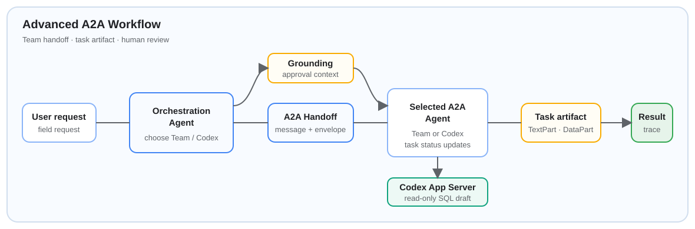

<table>
  <tr>
    <td width="48%" valign="top">
      <h1>04 · Agent Patterns</h1>
      <p>Workflow, tool calling, A2A를 비교하는 단계입니다.</p>
    </td>
    <td width="52%" valign="top">
      <a href="notebooks/04_agent_to_agent_advanced.ipynb">
        
      </a>
    </td>
  </tr>
</table>

> 공통 환경 설정과 JupyterLab 실행은 [루트 README](../README.md)에서 진행합니다. A2A 노트북은 별도 로컬 Agent 서버가 준비된 뒤 실행합니다.

---

<details>
<summary><strong>🔧 시작 전 확인</strong></summary>

| 실습 범위 | 필요한 준비 |
| --- | --- |
| 기본 workflow·tool calling | AI Core 인증 정보와 `LLM_MODEL` |
| 매뉴얼 grounding | 선택적으로 `GROUNDING_REPOSITORY_ID` |
| A2A 실습 | 03 또는 04에 맞는 로컬 A2A Agent 서버 |
| Codex App Server 예제 | 선택적으로 Codex CLI 설치 및 로그인 |

기본 도구는 읽기 전용 데이터를 사용합니다.

</details>

---

<details>
<summary><strong>📓 노트북 안내</strong></summary>

| 노트북 | 협업 패턴 | 무엇을 확인하나요? |
| --- | --- | --- |
| [01_agent_workflow.ipynb](notebooks/01_agent_workflow.ipynb) | 고정 전이 workflow | 코드가 정한 순서 안에서 LLM이 route를 선택하는 흐름을 확인합니다. |
| [02_agent_loop_mcp.ipynb](notebooks/02_agent_loop_mcp.ipynb) | Tool calling loop | 관찰 → 읽기 전용 도구 호출 → 재관찰의 반복과 Agent graph를 확인합니다. 별도 MCP 서버는 필요하지 않습니다. |
| [03_agent_to_agent.ipynb](notebooks/03_agent_to_agent.ipynb) | A2A | F&B Team Agent가 A2A Protocol 1.0의 Message·Task·Artifact로 handoff하는 방식을 확인합니다. |
| [04_agent_to_agent_advanced.ipynb](notebooks/04_agent_to_agent_advanced.ipynb) | Advanced A2A + Harness Labs | Team·Codex SQL Agent handoff 뒤 실행 trace를 분석하고, 사람 선택으로 개선안을 runtime overlay에 반영·롤백합니다. |
| [05_build_your_harness.ipynb](notebooks/05_build_your_harness.ipynb) | Build your harness | SAP BTP, Integration Suite MCP, Joule, HANA Cloud, LeanIX Agent Hub를 연결하는 운영 Harness 아키텍처와 구현 우선순위를 설계합니다. |

01부터 04까지 실행하면 Agent 협업 방식을 비교할 수 있습니다. 04에서는 Harness Labs가 개선안을 제안합니다.

</details>

---

<details>
<summary><strong>🖥️ A2A 실습 준비</strong></summary>

03과 04는 JupyterLab과 별도의 터미널에서 로컬 A2A Agent 서버를 실행한 뒤 시작합니다.

```bash
# 03 · A2A Team Agent 서버
.venv/bin/python main.py fnb-a2a-local

# 04 · Advanced A2A Team 및 Codex SQL Agent 서버
.venv/bin/python main.py fnb-a2a-advanced-local
```

04의 Codex SQL Generator Agent는 SQL 초안만 만들며 실행하지 않습니다.

</details>

---

<details>
<summary><strong>🔐 안전 경계</strong></summary>

- 기본 도구와 SQL Agent는 읽기 전용입니다.
- Harness Labs의 제안은 검토 후에만 적용합니다.
- Outlook은 초안만 만들며, 발송에는 별도 인증이 필요합니다.

</details>

---

<details>
<summary><strong>✅ 이 단계의 완료 기준</strong></summary>

각 Agent 패턴이 제어 흐름, 도구 권한, 조직 경계를 어떻게 다르게 다루는지 설명할 수 있어야 합니다. 테스트와 실행 명령은 [루트 README](../README.md)를 따릅니다.

</details>
