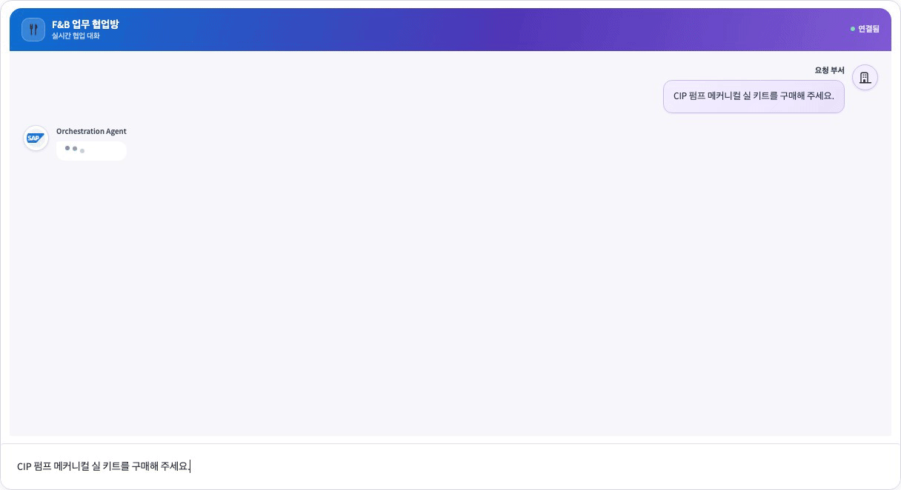
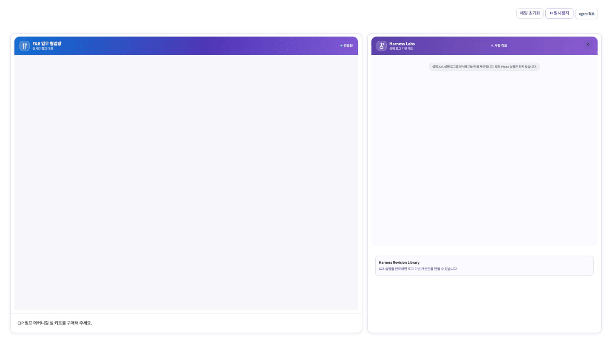
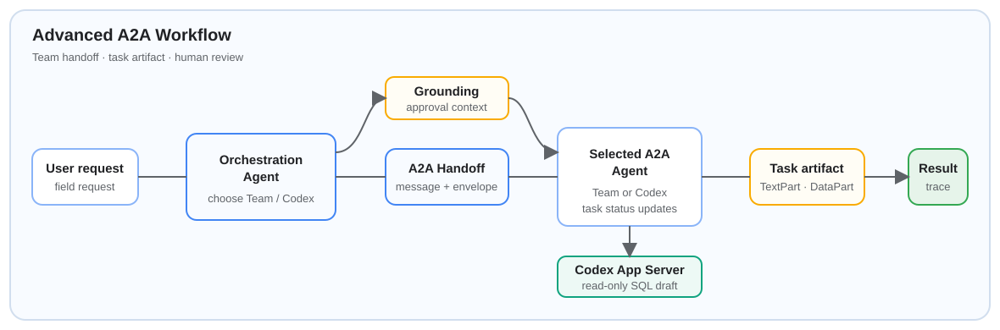

# Gen AI Hub Hands-on

BAIP를 통해 SAP BTP AI Core와 Gen AI Hub의 기능을 활용하고, **AI-First → AI-Native**로 이어지는 구현 방식을 이해하며 Joule A2A 구현을 위한 Hands-on을 진행하는 실습 저장소입니다.

> 각 노트북은 화면과 trace를 보여 주고, 실제 로직은 해당 단계의 `src/`에 있습니다.

### 🎬 Agent Patterns 미리보기

대표 협업 흐름을 01~03 순서로 미리 봅니다. 실제 Hands-on 단계와 노트북 번호는 아래 학습 로드맵의 01~04 구성을 따릅니다.

<strong>01 · 병렬 Agent Workflow</strong><br>
<br>
독립 Specialist Agent의 병렬 실행과 Synthesis 결과를 확인합니다.

<br>

<strong>02 · Agent-to-Agent 협업</strong><br>
<br>
요청부터 A2A handoff, 현업용 최종 업데이트까지 확인합니다.

<br>

<strong>03 · Agent-to-Agent 협업 with Expanding</strong><br>
<br>
부서별 A2A handoff와 최종 승인 대기 응답을 확인하고, Harness Labs가 실행 로그 기반 개선안을 제안합니다.

---

<details>
<summary><strong>🧭 학습 흐름</strong></summary>


```text
01. 환경 연결  →  02. LLM 활용  →  03. 서비스·Grounding  →  04. Agent 협업
```

| 순서 | 아젠다 | 핵심 실습 | 완료 기준 |
| --- | --- | --- | --- |
| **01** | [Gen AI Hub와 BTP AI Core](1_gen_ai_hub/) | AI Core 인증, deployment 조회, OpenAI-compatible 호출 | 비밀값 노출 없이 환경과 실행 중인 모델을 확인한다. |
| **02** | [Gen AI Hub LLM](2_gen_ai_hub_llm/) | Prompt, embedding, reranking, 비즈니스 임베딩 | 모델 응답·유사도·추천 score를 근거와 함께 해석한다. |
| **03** | [Gen AI Hub Services](3_gen_ai_hub_services/) | Orchestration, masking, document grounding, Object Storage | 서비스 응답과 grounding 문서 근거를 구분해 확인한다. |
| **04** | [Agent Patterns](4_agent_patterns/) | Workflow, tool calling, A2A, Advanced A2A | 제어 흐름·도구 권한·조직 경계에 맞는 협업 방식을 비교한다. |

권장 순서는 **01 → 02 → 03 → 04**입니다. 04의 A2A 실습은 별도 터미널에서 로컬 Agent 서버를 실행해야 합니다.

</details>

---

<details>
<summary><strong>🚀 시작하기</strong></summary>


### AI 코딩 도구로 한 번에 설정하기

Codex, Claude Code 또는 Cursor Agent를 사용한다면 아래 프롬프트를 채팅에 붙여 넣으세요. 터미널 명령을 직접 입력하지 않고 환경 설정과 기본 테스트까지 진행할 수 있습니다. 서비스 key 값은 도구 채팅에 붙여 넣지 말고, 생성된 `.env` 파일에 직접 입력하세요.

```text
현재 열려 있는 Gen AI Hub Hands-on 저장소의 로컬 개발 환경을 설정해줘.

1. 저장소 루트에서 Python 3.11 이상을 확인하고, 없으면 현재 버전을 알려줘.
2. 기존 .venv가 없을 때만 .venv 가상환경을 만들고, requirements.txt의 의존성을 설치해줘.
3. .env가 없을 때만 .env.example을 복사해서 .env를 만들어줘. 이미 .env가 있으면 절대 덮어쓰거나 내용을 출력하지 마.
4. .env에 사용자가 입력해야 할 AI Core 필수 변수(AICORE_BASE_URL, AICORE_AUTH_URL, AICORE_CLIENT_ID, AICORE_CLIENT_SECRET, AICORE_RESOURCE_GROUP, LLM_MODEL)의 이름만 안내해줘. 값이나 비밀정보는 읽거나 출력하지 마.
5. 설치가 끝나면 현재 운영체제에 맞는 .venv Python으로 아래 1~4단계 unit test를 모두 실행해줘. 외부 AI Core 호출이나 서버 기동은 하지 마.
   - 1_gen_ai_hub/tests
   - 2_gen_ai_hub_llm/tests
   - 3_gen_ai_hub_services/tests
   - 4_agent_patterns/tests
6. 테스트가 실패하면 소스·노트북·설정을 임의로 수정하지 말고, 실패한 테스트와 원인 요약을 알려줘.
7. 마지막에는 실행한 작업, 테스트 결과(통과/실패 수), 남은 사용자 작업(.env 값 입력), JupyterLab 실행 방법만 짧게 요약해줘.
8. Git 변경·커밋·push는 하지 말고, 실행 중인 서버도 시작하지 마.
```

---

### 1. 설치

저장소 루트에서 가상환경과 공통 의존성을 설치합니다.

**macOS / Linux**

```bash
python3 -m venv .venv && .venv/bin/python -m pip install --upgrade pip -r requirements.txt
```

**Windows PowerShell**

```powershell
py -m venv .venv && .\.venv\Scripts\python.exe -m pip install --upgrade pip -r requirements.txt
```

### 2. 환경 설정

`.env.example`을 복사한 뒤 AI Core service key와 모델명을 채웁니다. `.env`는 절대 Git에 커밋하지 않습니다.

```bash
cp .env.example .env
```

```dotenv
AICORE_BASE_URL=
AICORE_AUTH_URL=
AICORE_CLIENT_ID=
AICORE_CLIENT_SECRET=
AICORE_RESOURCE_GROUP=default
LLM_MODEL=
```

### 3. JupyterLab 실행

```bash
.venv/bin/python -m jupyterlab
```

Windows PowerShell에서는 `.venv/bin/python` 대신 `.\.venv\Scripts\python.exe`를 사용합니다.

</details>

---

<details>
<summary><strong>📚 아젠다별 실습</strong></summary>


필요한 아젠다를 펼쳐 상세 노트북과 실행 방법을 확인하세요.

<details>
<summary><strong>01 · Gen AI Hub와 BTP AI Core</strong> — 환경과 모델 연결</summary>


| 노트북 | 실습 내용 | 확인 포인트 |
| --- | --- | --- |
| `00_learning_roadmap.ipynb` | 전체 학습 흐름과 사전 준비 | 01~04 단계의 연결 관계를 이해한다. |
| `01_environment.ipynb` | 설정 누락과 RUNNING deployment 확인 | 비밀값 없이 인증·모델 상태를 점검한다. |
| `02_openai_compatible_chat.ipynb` | AI Core LLM 채팅 호출 | OpenAI-compatible 호출 결과를 확인한다. |

```bash
.venv/bin/python 1_gen_ai_hub/main.py status
.venv/bin/python 1_gen_ai_hub/main.py deployments
```

<details>
<summary>선택 실습: LiteLLM Proxy</summary>

`LITELLM_BASE_URL`, `LITELLM_API_KEY`, `LITELLM_MODEL`을 `.env`에 설정하면 OpenAI SDK 형식의 endpoint도 확인할 수 있습니다.

```bash
.venv/bin/python 1_gen_ai_hub/main.py litellm-status
```

</details>

</details>

---

<details>
<summary><strong>02 · Gen AI Hub LLM</strong> — Prompt·Embedding·Reranking</summary>


| 노트북 | 실습 내용 | 확인 포인트 |
| --- | --- | --- |
| `01_prompt_and_model.ipynb` | system/user prompt와 모델 응답 비교 | Prompt 조건이 응답 형식과 근거에 미치는 영향을 확인한다. |
| `02_embeddings.ipynb` | embedding과 cosine similarity | 문장 간 유사도를 수치와 맥락으로 함께 해석한다. |
| `03_embedding_advanced.ipynb` | 비즈니스 문의 clustering | 라벨 기반 domain adapter 결과를 확인한다. |
| `04_reranker_decision_model.ipynb` | 정책 후보 reranking | 낮은 score 또는 작은 margin은 사람 검토로 보낸다. |

필요한 경우 `.env`에 `EMBED_MODEL`과 `RERANK_MODEL`을 설정합니다. 외부 reranker 또는 Harness decision model은 `RERANK_ENDPOINT`, `RERANK_API_KEY`로 연결할 수 있습니다. score와 margin은 자동 승인·반려가 아닌 사람 검토 우선순위를 정하는 근거로만 사용합니다.

</details>

---

<details>
<summary><strong>03 · Gen AI Hub Services</strong> — Orchestration·Grounding</summary>


| 노트북 | 실습 내용 | 확인 포인트 |
| --- | --- | --- |
| `01_orchestration.ipynb` | Orchestration 호출, prompt templating, 필터·마스킹 | 등록된 서비스를 조회하고 호출 결과를 확인한다. |
| `02_grounding.ipynb` | 문서 chunk 기반 질의 | 답변과 함께 참조한 문서 근거를 확인한다. |
| `03_rpt_risk_classification.ipynb` | SAP RPT 교육용 holdout 평가·단건 분류 | feature·label만 전달하고, 지표·감사 집계를 사람 검토용으로 확인한다. |

Grounding에는 `GROUNDING_REPOSITORY_ID`가 필요합니다. Object Storage 연계는 선택 사항이며, 원본 문서는 Storage에 보관되고 질의는 인덱싱된 vector chunk를 근거로 수행합니다. RPT 실습은 RUNNING foundation-model deployment에 읽기 전용 예측만 요청하며, 학습 실행·deployment 생성·자동 신용 의사결정은 수행하지 않습니다.

```bash
.venv/bin/python 3_gen_ai_hub_services/main.py rpt-evaluate
```

</details>

---

<details>
<summary><strong>04 · Agent Patterns</strong> — Workflow·Tool Calling·A2A</summary>

<p align="right">
  <a href="4_agent_patterns/notebooks/04_agent_to_agent_advanced.ipynb">
    
  </a>
</p>

| 노트북 | 협업 패턴 | 확인 포인트 |
| --- | --- | --- |
| `01_agent_workflow.ipynb` | 고정 전이 workflow | 코드가 제어하는 LLM workflow와 route 선택을 확인한다. |
| `02_agent_loop_mcp.ipynb` | Tool calling loop | 관찰 → 읽기 전용 도구 호출 → 재관찰 흐름을 확인한다. |
| `03_agent_to_agent.ipynb` | A2A | Message·Task·Artifact 기반 handoff를 확인한다. |
| `04_agent_to_agent_advanced.ipynb` | Advanced A2A | Team 협업과 선택적 Codex App Server/SQL Agent를 확인한다. |
| `05_build_your_harness.ipynb` | Build your harness | SAP BTP 기반 Harness의 실행·도구·Agent·거버넌스 아키텍처와 구현 순서를 설계한다. |

04 Advanced A2A는 실행 trace를 Harness Labs에서 분석해 개선안을 제시하고, 사람이 선택한 revision만 세션의 runtime overlay로 반영합니다. 반영 전·후의 실행 흐름은 비교할 수 있으며 원본 Prompt·Tool·SOP는 변경하지 않습니다.

03·04를 실행하기 전에 JupyterLab과 별도의 터미널에서 아래 서버를 시작합니다.

| 노트북 | 실행 명령 | 포트 |
| --- | --- | --- |
| 03 `agent_to_agent` | `.venv/bin/python 4_agent_patterns/main.py fnb-a2a-local` | 9111~9122 |
| 04 `agent_to_agent_advanced` | `.venv/bin/python 4_agent_patterns/main.py fnb-a2a-advanced-local` | 9211~9223 |

</details>

</details>

---

<details>
<summary><strong>🔐 환경변수와 안전 경계</strong></summary>


| 기능 | 추가 환경변수 | 사용 단계 |
| --- | --- | --- |
| 임베딩·reranker | `EMBED_MODEL`, `RERANK_MODEL` 또는 `RERANK_ENDPOINT`, `RERANK_API_KEY` | 02, 04 |
| SAP RPT | `RPT_MODEL`, 선택적으로 `AICORE_RPT_DEPLOYMENT_ID` | 03 |
| Grounding | `GROUNDING_REPOSITORY_ID`, 선택적으로 `AICORE_ORCHESTRATION_DEPLOYMENT_URL` | 03, 04 |
| Object Storage | `OBJECT_STORAGE_ENDPOINT`, `OBJECT_STORAGE_ACCESS_KEY_ID`, `OBJECT_STORAGE_SECRET_ACCESS_KEY`, `OBJECT_STORAGE_BUCKET` | 03 |
| LiteLLM Proxy | `LITELLM_BASE_URL`, `LITELLM_API_KEY`, `LITELLM_MODEL` | 01 (선택) |
| Outlook 발송 | `ALLOW_WRITE_TOOLS=true` 및 Graph/EAI 관련 값 | 04 (선택) |

- service key, API key, access key는 노트북 출력·로그·Git에 남기지 않습니다.
- 기본 예제와 fixture 기반 Tool은 읽기 전용입니다.
- SAP RPT 예측에는 교육용 feature·label만 전달하며, 식별자와 감사 속성은 로컬 검토 범위에 둡니다.
- Outlook 발송은 UI에서 사람이 내용을 확인·승인하고, 별도 인증과 `ALLOW_WRITE_TOOLS=true`가 모두 설정된 경우에만 가능합니다.
- Grounding과 Object Storage에는 실습 권한 범위의 문서만 사용합니다.

</details>

---

<details>
<summary><strong>✅ 검증</strong></summary>


```bash
.venv/bin/python -m unittest discover -s 1_gen_ai_hub/tests -v
.venv/bin/python -m unittest discover -s 2_gen_ai_hub_llm/tests -v
.venv/bin/python -m unittest discover -s 3_gen_ai_hub_services/tests -v
.venv/bin/python -m unittest discover -s 4_agent_patterns/tests -v
```

</details>
